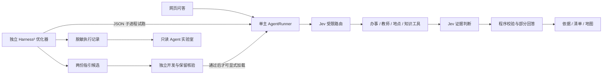

# CampusPilot 比赛版设计与运行说明

批准方案见 [ADR 0008](adr/0008-harness-optimization-and-jev-routing.md)。本轮本地实现未生产部署。

实现、真实对照、采用决定与验证结果见 **[实施报告](qa/harness-jev-20261020.md)**；
评审操作见 [演示脚本](DEMO_SCRIPT.zh-CN.md)，运行身份见
[版本清单](../evaluation/agent-lab-20261020/submission-version.json)。

## 作品与三个创新点

理小龙帮助用户把校园问题转成有依据的下一步：查询官方资料、选择办事事项、准备清单、查看建筑
与参考路线。桌面是主要演示端，手机保持现有能力；图片保留既有阅读和地点匹配，不新增个人待办。

| 创新点 | 实现 | 应展示的证据 |
| --- | --- | --- |
| 校园任务联动 | 单主 Agent＋目录/RAG＋地图＋办理清单 | 办事回答、引用、保存与恢复清单、地点和路线 |
| Harness² 策略优化 | 原上游递归流程＋CampusPilot adapter＋不可变策略 | 候选文件差异、真实工具轨迹、答复、经验和对照 |
| Jev 决策 | 受限工具组合路由＋本地/联网证据判断 | 实际执行记录、故障回退、分项开关对照 |

本项目贡献是校园任务适配、受限策略接口、证据治理、演示和独立验收；Harness² 算法本身来自
[Google Research 上游](https://github.com/google-research/harness2)，按 Apache-2.0 使用。



## Harness² 的一次完整执行

模型本身不训练。原框架先执行任务，改进者读取其实际工具与回答，提出通用/领域策略修改；
候选重新执行同题，再综合配置，保存采用记录和跨任务经验。官方无模型示例已经实际完成两项账目任务，
14 次执行、16 次脚本化编辑调用；它证明机制接线，不证明校园模型效果。

CampusPilot 的可编辑内容只有 `answer_guidance.md` 与 `tool_guidance.md`，每份不超过 6000 字符。
二者生成带版本和 SHA-256 的 `HarnessProfile`，按请求注入固定应用协议之后。工具白名单、
参数 schema、权限、引用验证、校区/身份/学年过滤仍由程序执行。未配置 profile 时维持原路径。
任务级候选不能自动成为全局默认配置，效果不佳时保留基线。

优化使用独立 Linux/WSL 的 Python 3.12；校园任务执行与普通网页均为 Python 3.14.7。
原 OpenCode 通道负责编辑策略，校园回答始终由真实 `AgentRunner` 执行。
上游仅补充 CampusPilot 可编辑配置描述；调度、递归、选择和经验库算法不改。

## Jev 与接口

2026-10-21 的新生体验增量按[产品边界](PRODUCT.md)实现：明确的入口或目录地点先直达，
材料和长步骤按需展开。普通网页启用简洁模式，实验用 `AgentRunner` 的默认行为仍兼容既有对照。
Jev 用于疑难路由与证据核对；Harness² 仍是离线策略优化。实现、实测和未完成门槛见
[交付说明](STUDENT_EXPERIENCE.zh-CN.md)与[核验报告](qa/student-experience-20261021.md)。视频后置。

意图识别后，Jev 在办事、教师、地点、知识、地点加知识等既定组合中选择；不直接提供执行参数。
实际缺失用户条件、闲聊由现有程序处理。无效或不确定选择回退到确定性规划器。
检索后判断是否需要补证，联网后核对新官方正文；只具有标题/摘要的线索不能成为政策依据。
路由至多一次、证据至多两次，缓存共享总上限，单次两秒。已知部分应保留，未知项明确说明。

聊天请求保持兼容；响应新增可选 `decisions`、`harness_profile`，SSE 新增可选 `decision` 事件。
执行记录只展示结构化阶段、动作、状态与耗时，不输出原始判断提示或模型内部推理。

| 配置 | 用途 |
| --- | --- |
| `CAMPUSPILOT_JEV=off/shadow/on` | 证据判断模式 |
| `CAMPUSPILOT_JEV_ROUTING=on` | 独立启用路由；证据 off 时仍可只测路由 |
| `CAMPUSPILOT_HARNESS_PROFILE` | 已审查 profile JSON 的路径；空值为基线 |
| `CAMPUSPILOT_LAB_RECORDS_DIR` | 严格公开实验 JSON 所在目录 |

`GET /lab` 打开展示，`GET /api/lab/experiments` 返回列表，
`GET /api/lab/experiments/{id}` 返回验证后的公开记录；没有启动、上传或修改实验的公共 API。
默认查看已完成实验，运行中的记录按实际落盘进度刷新。所有展示文字使用文本 DOM，不渲染模型 HTML。

## 安装、实验与预算

普通开发仍用项目 `uv.lock` 与既有启动方式。可选优化环境：

普通作品运行包不需要 Git 历史或优化环境。若从源码 ZIP 复现实验，先克隆本仓库并检出版本清单的
Git 基线，再将源码包覆盖到该工作树（保留 `.git`），以便实验命令核对源码身份。

```bash
bash integrations/harness2/setup.sh
.cache/harness-env/bin/python integrations/harness2/setup_editor.py
.cache/harness-env/bin/python integrations/harness2/verify_adapter.py
```

在仓库外建立 `experiment-config.json`，仅填写 `deepseek_key_file` 和 `jev_key_file` 两个绝对路径。
文件本身和密钥均不提交。在 WSL 中使用 Linux 可访问的路径。不要直接输出密钥。

```bash
CP=.cache/campus-env/bin/python
$CP scripts/run_agent_lab.py smoke --config /absolute/private/experiment-config.json --output output/my-experiment
$CP scripts/run_agent_lab.py optimize --config /absolute/private/experiment-config.json --output output/my-experiment
$CP scripts/run_agent_lab.py development --config /absolute/private/experiment-config.json --output output/my-experiment
# 如优化与评测源码不同，用新输出目录和 --candidates-from 导入完成的综合候选，保留原身份。
# 逐题独立审查开发结果后，使用 freeze_agent_profile.py --evaluation-only 冻结评测候选。
# 该命令要求 --candidate、--reviews、--observations、--destination；具体样例见本轮开发审查 JSON。
# 冻结候选后才运行 holdout；不能按保留集反复调优。
$CP scripts/run_agent_lab.py holdout --config /absolute/private/experiment-config.json --output output/my-experiment
$CP scripts/run_agent_lab.py export --config /absolute/private/experiment-config.json --output output/my-experiment
```

12 开发＋12 保留任务覆盖办事、教师、地点、政策、组合、信息不足。16 题绑定此前已核对原文并重新
验证哈希/引句，8 题只检查公开目录契约及未知边界，不能称其原始网页或现场重新认证。
原文与目录题分项报告，现有 60 题知识发布门槛不受影响。
任务、源码、模型、目录、知识快照和 profile 均绑定身份；执行者/改进者看不到审查标签。

计费网关按每次外部请求持久预留，再按已知 usage 结算；超时或未知保留预留。
所有实验共用一个不随日期或输出目录重置的 20 美元账本。DeepSeek 采用官方峰值上限
输入 $0.3/M、输出 $1.2/M；Jev 输入 $0.042/M、输出 $0/M（2026-10-20 核对）。
费用是根据用量估计的保守占用，不冒充账单；首次两题成功后再扩大。未知价格、模型不匹配、
未经计价的服务器工具和预算耗尽均阻止调用，不自动充值。

本轮采用决定是**不全局启用候选**，正常问答保持基线。研究候选与原始结果仍随源码提供。
`freeze_agent_profile.py` 的普通采纳模式要求 12 项保留审查、文件哈希不变、无关键核验阻断，
并有明确收益；开发集评测冻结与生产采纳不是同一操作。

本地普通运行可设置 `CAMPUSPILOT_RUNTIME_MODE=phase2`、`CAMPUSPILOT_AGENT_LOOP=on`，
并将 `CAMPUSPILOT_LAB_RECORDS_DIR` 指向 `evaluation/agent-lab-20261020/public`。
提交运行包沿用 `approved-20261011b`，设置 `CAMPUSPILOT_KNOWLEDGE_BUNDLE=approved-20261011b`；
本地实验的 `kb-229ee34eba99ef34` 不因完成策略实验自动成为新发布知识包。
常规 API 凭据从仓库外 `CAMPUSPILOT_MODEL_KEY_FILE`、`CAMPUSPILOT_JEV_KEY_FILE` 加载。
继续本轮付费验证应使用同一个活动账本和计费网关，不能用普通启动绕过 $20 上限。

## 演示与交付

1. 从补卡问题进入官方依据、准备清单，保存后新建对话，确认清单和勾选进度仍在。
2. 选择有依据的建筑地点与起点，展示参考路线；不把室内入口、设备可用性或路线到达当成办理成功。
3. 展开 Jev 执行记录，说明工具选择、充分性与回退。图片可作辅助输入，不能升级为现行学校政策。
4. 打开实验室，比较真实基线/候选答复、策略差异、经验和成本，说明是否采用及其验收依据。

四项原有服务补充显式 `procedure` 标注，依据 10 月 17 日既有来源审查；没有重写步骤、费用或时效。
旧保存清单保持可读；指南不能伪装成完整流程。代码与匹配目录必须共同打包。

交付包含本设计、源码/依赖、启动说明、公开实验记录、演示脚本与版本清单。
发布前仍须核对完整源码/知识/profile 身份、目标 Linux 检查、现场演示，并经 Tech Lead 审阅。
本轮不推送、合并、标记最终线上版本或切换未达标知识候选。
