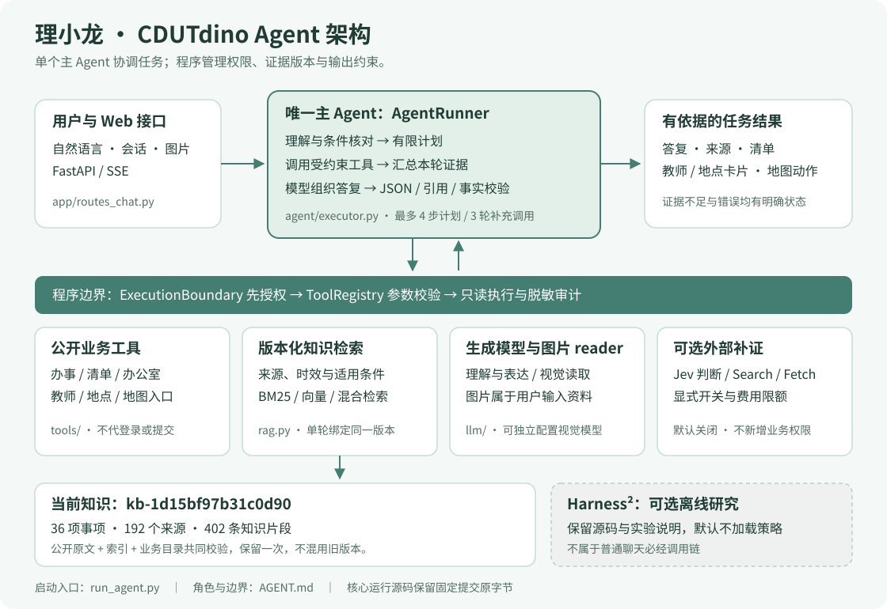

# 架构：一个主 Agent，受约束的工具

理小龙采用单个主 Agent 加模块化工具。FastAPI 负责会话、图片和 SSE 接口；`AgentRunner` 负责理解任务、协调证据和组织答复。模型负责理解与表达，程序负责计划边界、工具授权、数据版本、清单与地图动作、结果校验。

## 从问题到结果

以“校园卡补办需要什么材料”为例，理解模块提取事项及用户已给出的条件，程序按意图选择办事检索、知识检索和清单工具。工具返回带来源的业务记录与原文片段。主 Agent 在这些证据范围内组织答复，程序校验引用和关键限制，再向浏览器输出答案、来源及清单。地点问题可生成地图动作；需要实时资料时，只有显式开启的联网能力可以补充外部证据。

## 与代码对应

| 层次 | 主要文件（相对 `backend/src/campuspilot/`） | 职责 |
| --- | --- | --- |
| 应用装配 | `app/main.py`、`app/factory.py` | 读取配置并构造同一套 Agent、知识、工具与 Web 接口 |
| 主 Agent | `agent/executor.py` | 单轮协调、有限工具循环、图片与联网任务协调 |
| 理解与计划 | `agent/understand.py`、`agent/plan.py` | 条件核对、意图、最多 4 步计划 |
| 工具边界 | `agent/execution.py`、`tools/base.py` | 先授权再执行、参数校验、审计元信息 |
| 业务工具 | `tools/directory.py`、`checklist.py`、`teachers.py`、`places.py` | 公开目录、清单、教师与地点 |
| 知识检索 | `rag.py`、`retrieval/`、`tools/knowledge.py` | 版本固定、BM25/向量/混合检索、适用条件过滤 |
| 结果约束 | `agent/structured_answers.py`、`verify.py`、`responses.py` | JSON 解析、引用及事实约束、明确降级状态 |
| 外部能力 | `llm/`、`jev_plugin.py`、`web_evidence.py`、`app/amap.py` | 生成/读图模型、证据判断、Search/Fetch、地图 |
| 展示 | `app/routes_chat.py`、`web_assets/v2/` | SSE 事件、松绿界面、清单、地图与恐龙 |

## 数据、权限和扩展边界

- 知识：`data/knowledge.zip` 在启动前校验并还原，`current.json` 指向唯一提交知识 `kb-1d15bf97b31c0d90`。来源原文、402 条知识片段、192 个来源和 36 项办事记录同版本绑定。应用启动后绑定目录和检索，单轮固定同一知识视图，避免混用两个版本。
- 权限：模型只能使用声明的能力；默认只读公共信息。上传与删除图片属于用户主动触发的会话操作，地图使用用户允许的定位；Agent 不操作校内登录系统。
- 模型：兼容 Chat Completions 的主模型负责理解与回答；可单独配置视觉 reader。reader 不新增业务权限。
- Jev/Search：可选的判断与补证能力，共用受限费用账本。Jev 不替代主 Agent；缺失配置不被记为已完成核验。
- Harness²：可选离线策略研究，源码和实验说明放在 `integrations/harness2/`。本包不启用实验 profile，不将离线优化器接入普通聊天调用链。

## 对评委的阅读提示

先看 `AgentRunner`、`agent_registry` 和 `SnapshotStore`，即可定位“决策、动作、证据”三个责任边界。兼容旧接口所需的薄封装仍保留在导入闭包中；`skills.py` 的早期合成示例不是当前产品的工具注册入口，不能据此理解当前架构。真实注册以 `agent_registry` 为准。

此包整理交付边界与说明；核心 Agent 架构保持原实现，另有两处 SQLite 文件 URI 转义用于适配 Windows 扩展路径。版本身份、未变文件来源及这两处修改的哈希见根目录 `PACKAGE.json`。
