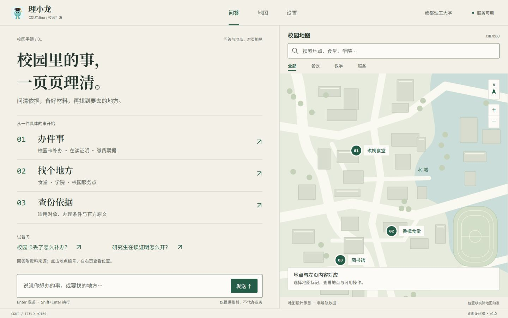
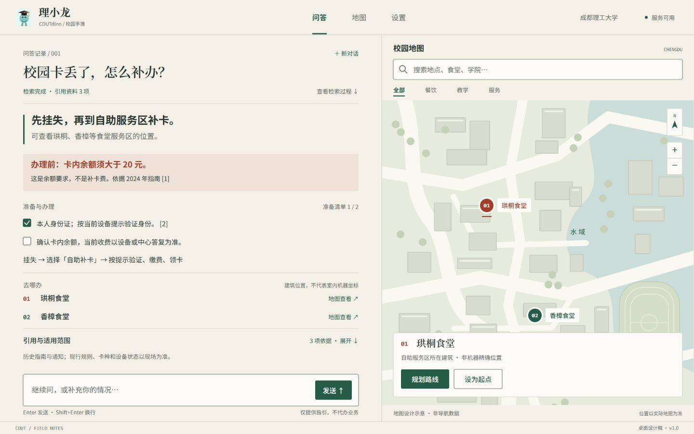
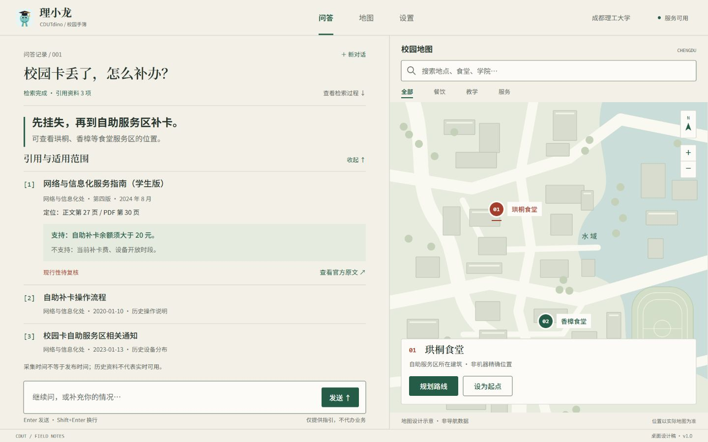
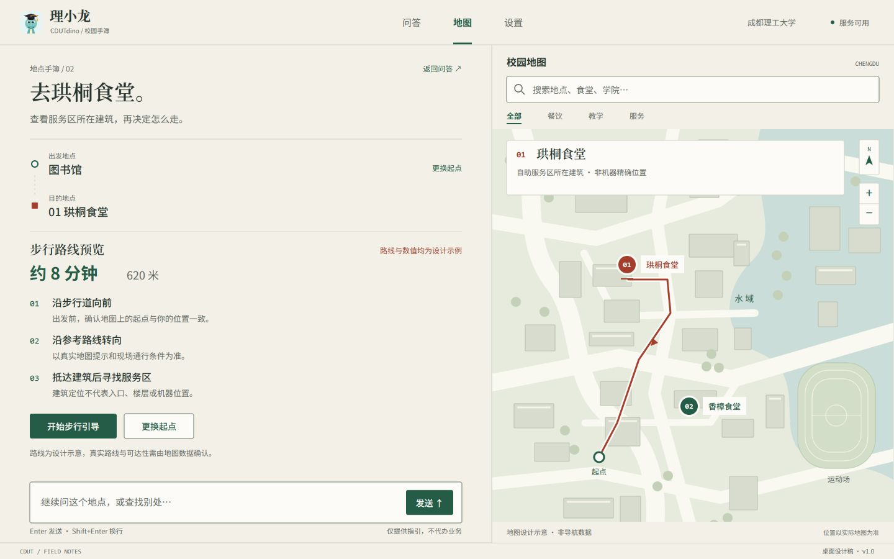
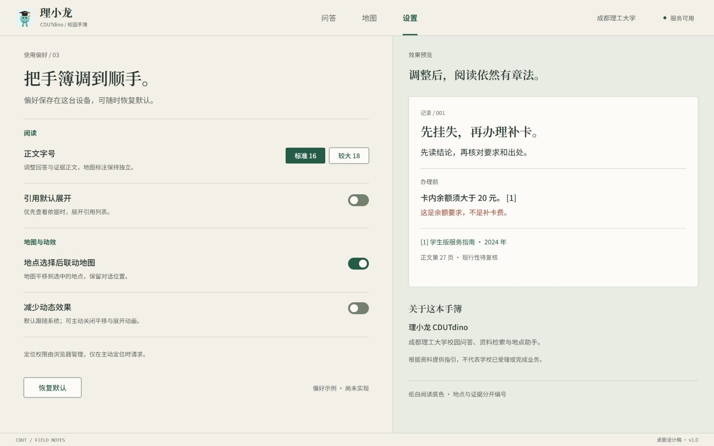
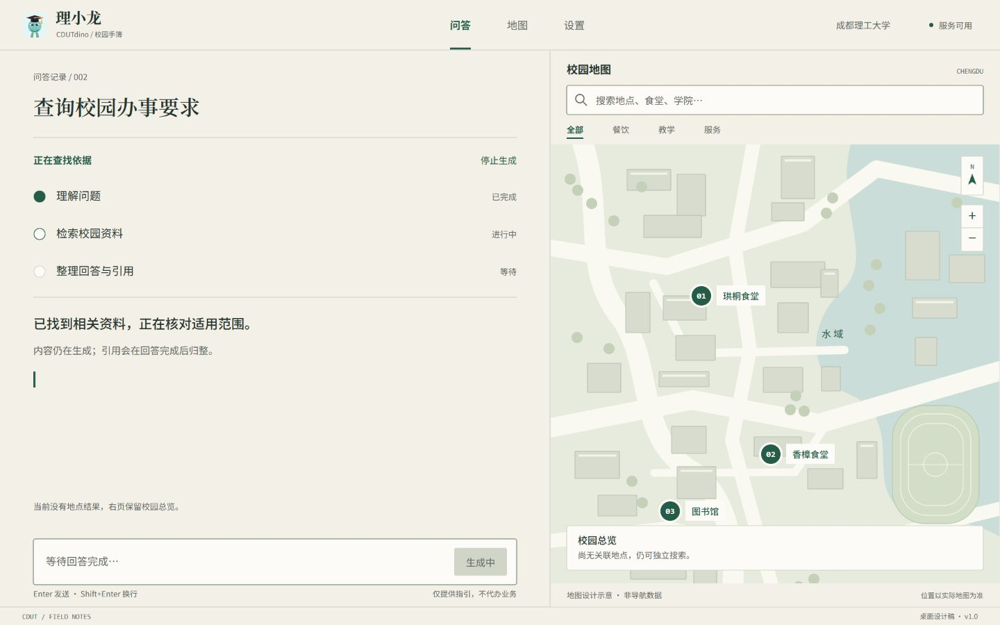
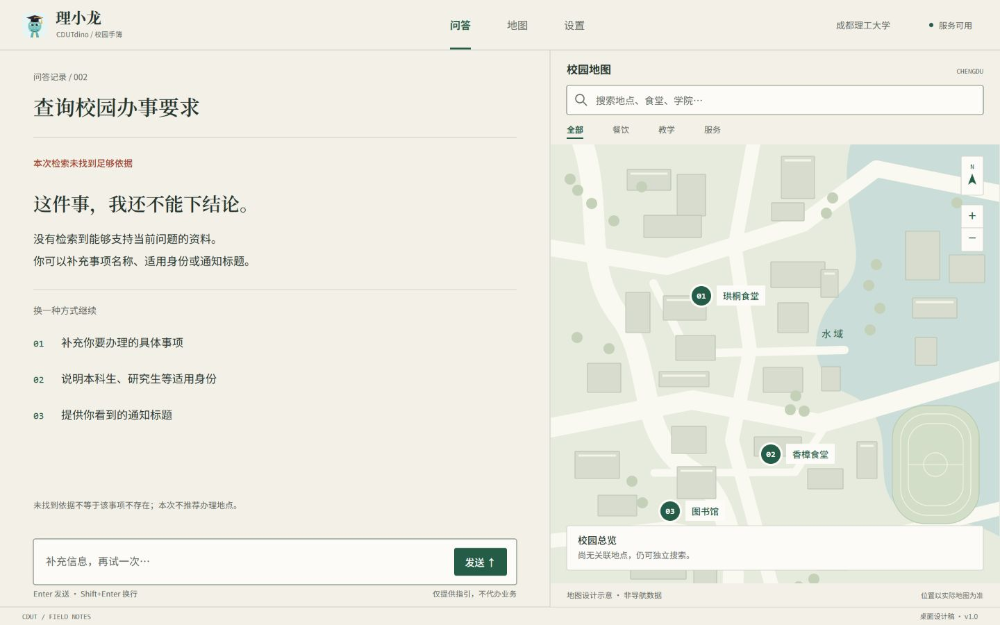
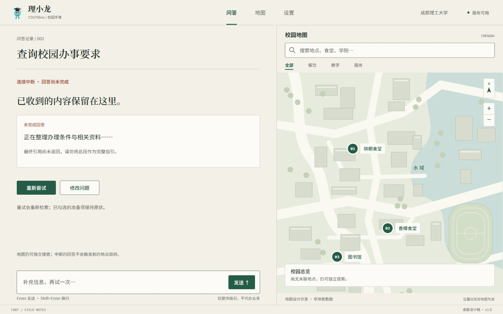

# 理小龙 CDUTdino · 桌面设计交付

Concept「地质野外手簿」/ Direction 01「对页手簿」。

- [DESIGN.md：设计规范、动效、断点与接口差距](DESIGN.md)
- [CRITIQUE.md：两套逐屏检查与修改记录](CRITIQUE.md)
- [verification.json：渲染尺寸、对比度与边界核对](review/verification.json)

8 个场景，16 张浏览器渲染截图，16 份可编辑 SVG。1440×900 为主稿，1280×900 为紧凑桌面校验稿。本交付只包含设计资产与文档，没有修改应用代码。

## 首页

## 问答

## 引用与证据

## 地图与路线

## 设置

## 流式生成

## 无依据

## 连接中断

这些是浏览器渲染的**静态设计稿**，不是已实现产品截图。地图形状、路线与距离时间为标明的设计示例；真实产品需使用地图服务的数据。
