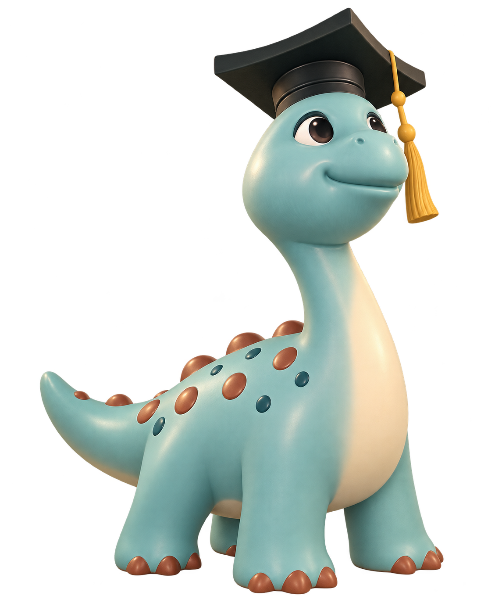

# 理小龙 · 品牌图标与 3D 吉祥物 V2

2026-10-13 · 设计资产 · **PROPOSED**

基于用户提供的四张蓝绿色长颈恐龙实物照片重设计。保留校园原型的学士帽、金色流苏、长颈四足、奶油色腹部与圆斑；去除胶带、尾部破损和实物环境。与「地质野外手簿」的纸色、墨绿和赭色相配。

## 交付

| 资产 | 格式 / 尺寸 | 用途 |
| --- | --- | --- |
| [品牌图标](cdutdino-icon.png) | RGBA PNG · 1254×1254 | 导航栏标识、助手头像 |
| [3D 吉祥物](cdutdino-mascot-3d.png) | RGBA PNG · 1145×1374 | 首页欢迎、品牌介绍 |

两张均检查到 alpha 范围 0–255，包含真实透明区域。保留原始生成分辨率。图标是位图设计稿，尚未矢量化；3D 是渲染图，未交付网格、骨骼或 GLB。原有页面画板与截图保留此前版本，此目录作为品牌替换方案独立交付，尚未回填全部页面或改动应用代码。

## 识别与使用规范

- 图标通过学士帽、圆吻与弯颈建立识别；缩短颈部使其更适合头像，不用全身恐龙压缩成导航标记。
- 推荐导航显示框 40–48 px、助手头像 48–64 px；当前位图未做 16 px favicon 光学校正，不直接用于该尺寸。
- 安全区域沿用图片透明边距，不拉伸、不裁掉帽尖或流苏。优先放在纸色 `#F3F0E7` 或浅色背景；深色底需另做反白版本。
- 3D 吉祥物保持比例，建议显示高度 240–360 px；只用于首页欢迎或品牌介绍，不挤占答案、证据和地图信息。
- 3D 的柔和高光用于表达体积；界面面板继续使用无渐变、无装饰投影的原有规范。
- 不给吉祥物叠加气泡、闪光、背包等新符号；语言、证据与地图仍承担功能说明。

## 参考配色

| 用途 | 色值 |
| --- | --- |
| 矿物青主体 | `#81B5AD` |
| 象牙色腹部 | `#EEE4CC` |
| 深绿帽子与轮廓 | `#26342E` |
| 金色流苏 | `#D3A344` |
| 陶土色圆斑 / 背部凸起 | `#A65D45` |

以上是后续矢量 / 建模的目标色值，不代表生成图片逐像素精确匹配；3D 光照会改变实际明暗。

## 动效提案

| 触发 | 表现 | 时长 / 缓动 | 目的 |
| --- | --- | --- | --- |
| 首次进入欢迎页 | 整体透明度 0→1，上移 4 px | 240 ms / cubic-bezier(.2,.7,.2,1) | 让角色出现，不抢输入框焦点 |
| 点击图标返回首页 | 图标自身不弹跳；页面执行既有切换动效 | 沿用页面规范 | 保持识别轮廓稳定 |
| reduced-motion | 直接显示，取消位移 | 0 ms | 避免非必要运动 |

当前 PNG 不支持独立眨眼、转头或流苏摆动；这类动作需要分层资产或后续 3D 模型，未在本轮宣称完成。

## 自查与精修

- 校园原型识别：保留青色长颈恐龙与学士帽；没有误用照片背景中的绿色恐龙。
- 形体：3D 保持四足、尾巴与完整帽子，未混成双足霸王龙。
- 图标首轮问题：颈部过长、帽带和流苏细节过多；精修缩颈、合并流苏并移除帽带。
- 图标与 3D 一致性：相同圆吻、色彩、帽子和流苏，分别匹配小尺寸识别与大尺寸角色表达。
- 透明与边界：两张均为 RGBA，透明区域存在，主体没有明显截断；尚未完成各背景下的像素级边缘验收。
- 去模板感：保留用户照片中的具体校园符号，没有添加通用机器人或光球。

使用内置 image_gen 生成并进行一轮图标精修；[完整提示词](PROMPTS.md)。本轮自查属于视觉设计检查，不等同于小尺寸可用性测试或模型交付验收。
