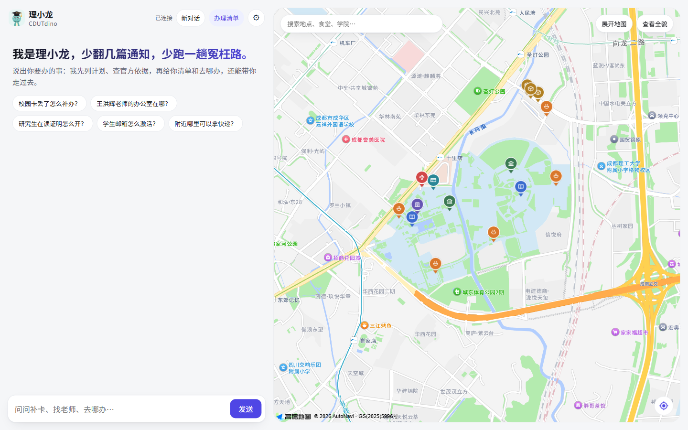
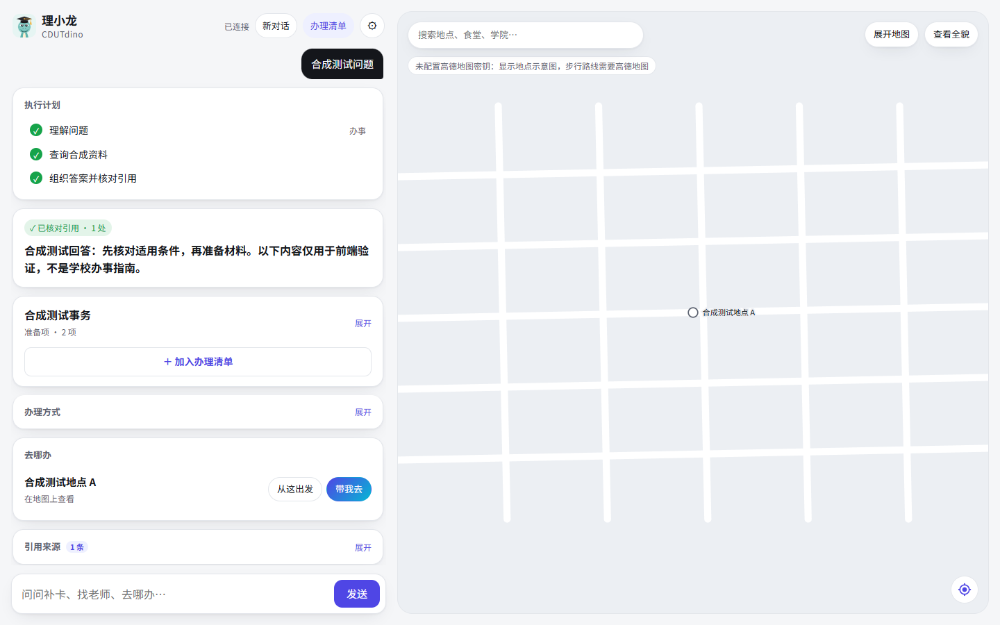
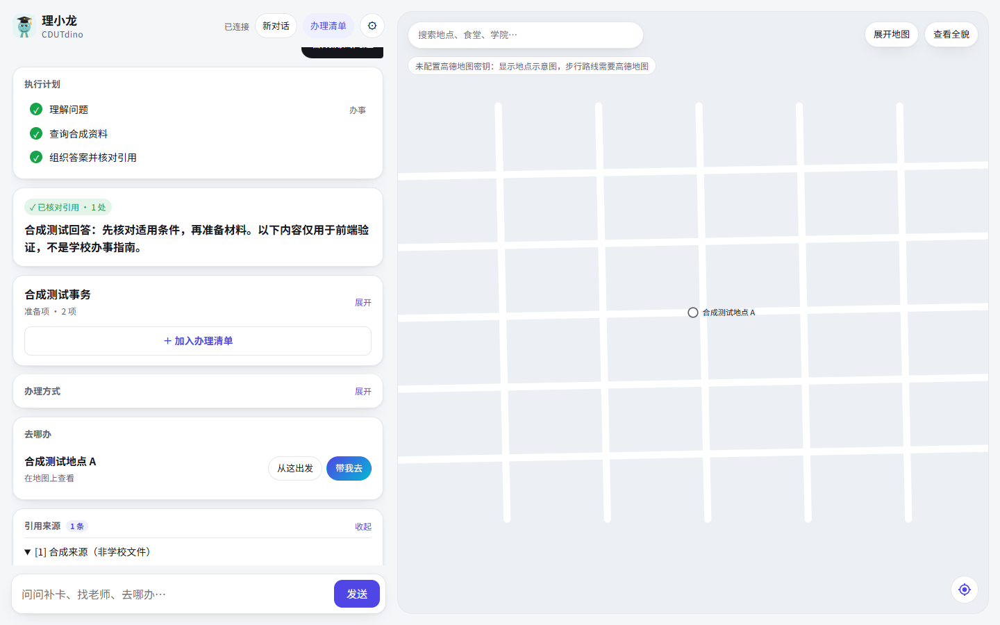
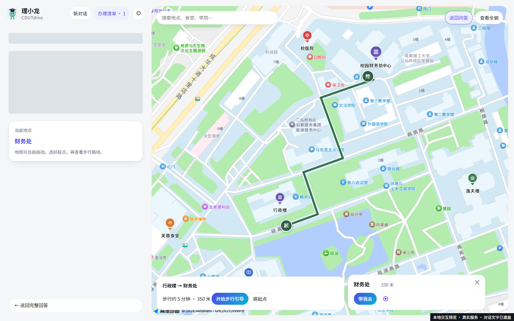
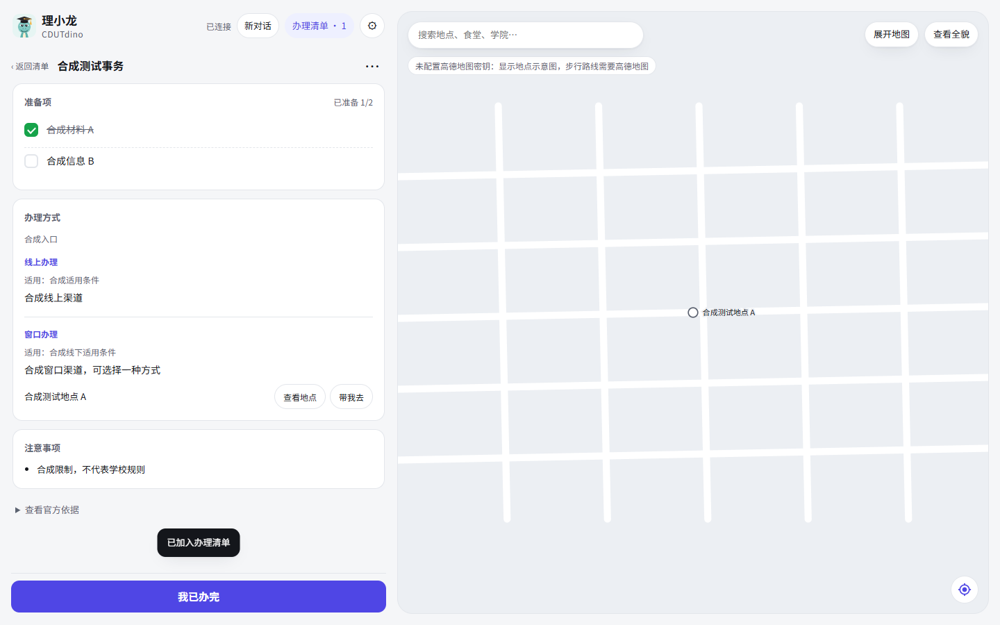
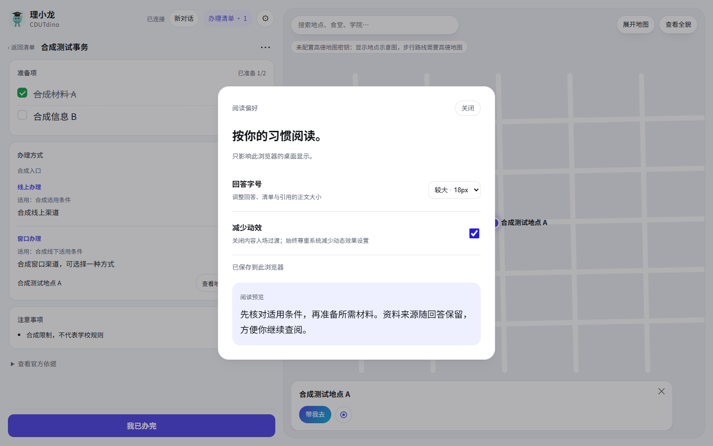

# 保留线上外观的桌面交互原型

**PROPOSED · 首轮体验记录。** 按最新反馈保留线上紫色、圆角、文案和双栏，增加可打断动效与明确的地图控制。未发布、未合并。本目录截图为前一轮；最新的图标、引导修复与 Blender 模型见 [guide-v2](../guide-v2/README.md)。

- [1440×900 交互录屏：真实服务，对话文字已遮盖](interactions-1440.webm)
- [设计与动效规范](../../../DESIGN.md)
- [实际 Skill 使用记录](SKILLS.md)
- [验证、性能数据与限制](VALIDATION.md)

## 首页 · 真实地图



[1280×900](screenshots/home-1280.png) · [1920×900](screenshots/home-1920.png)

## 问答与引用 · 明确标注的合成测试数据

这些可读的截图使用合成回答与示意图，不能作为校园办事规则或真实路线。真实问答已另外通过端到端验证，生产文字未归档。




## 地图与真实路线 · 对话文字已遮盖



## 办理清单与阅读偏好 · 合成数据




## 异常与窄屏回归

[SSE 中断](screenshots/interrupted-1280.png) · [路线失败](screenshots/route-error-1440.png) · [390px 原有清单](screenshots/regression-390.png)

## 复现与本地体验

当前工作目录：`D:\Projects\CampusPilot-desktop-field-notes`。本地静态预览服务为 `http://127.0.0.1:8875/`；未配置服务时会明确显示示意地图。

真实体验在 Playwright 的隔离浏览器 `wayfinding-live` 中：只把正式域名的首页与静态资源替换为本地文件，真实 API / 地图保持正式服务。原站、其他浏览器和新打开的正式域名标签页没有被替换。不要把浏览器里的正式域名误认为已上线新版。

用户可见预览使用独立 Chrome 窗口 `rounded-preview`，必须带 `--headed`；普通自动化会话默认无窗口。窗口标签标题为「本地交互预览（未发布）· 理小龙」。在本工作目录、预览服务运行时可重新打开：

```powershell
npx --yes --package @playwright/cli playwright-cli -s=rounded-preview open about:blank --browser chrome --headed
npx --yes --package @playwright/cli playwright-cli -s=rounded-preview run-code --filename tests/browser_rounded_preview.js --raw
```

干净浏览器可用 `tests/browser_rounded_preview.js` 打开预览（不自动发送问题），`tests/browser_wayfinding_live.js` 复现覆盖与完整任务。`tests/browser_wayfinding.js` 为合成状态回归；`tests/browser_wayfinding_interaction.js` 在真实任务脚本后运行；延迟流脚本应另开上下文。

先体验这一条路径，认可后再开展完整第二轮；本文件没有把原型声明为最终发布版本。
